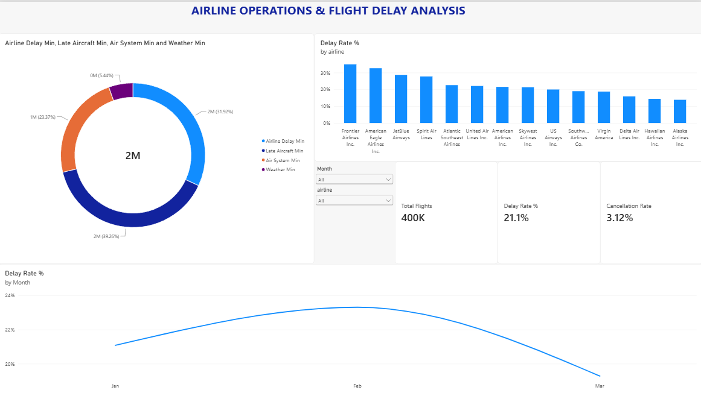
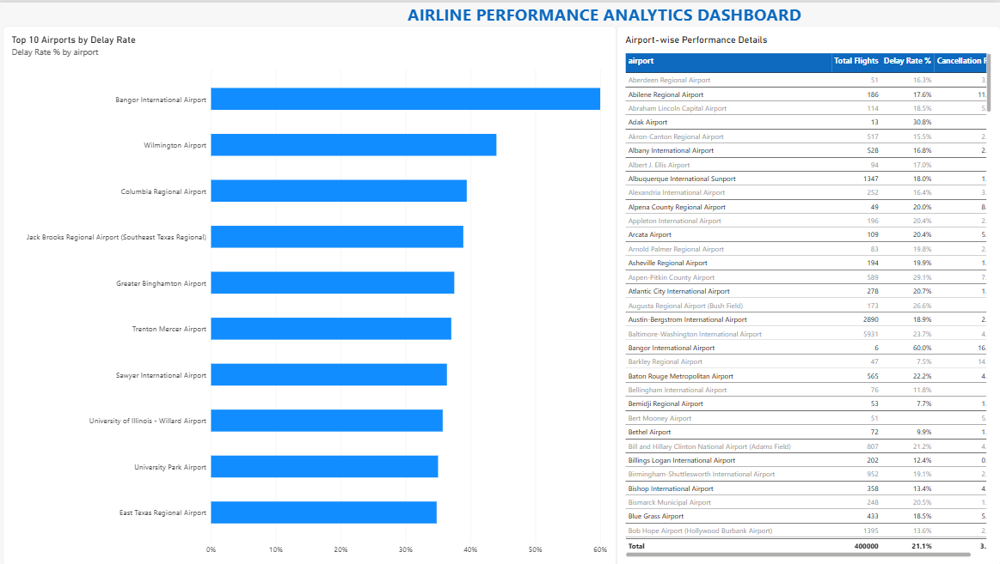
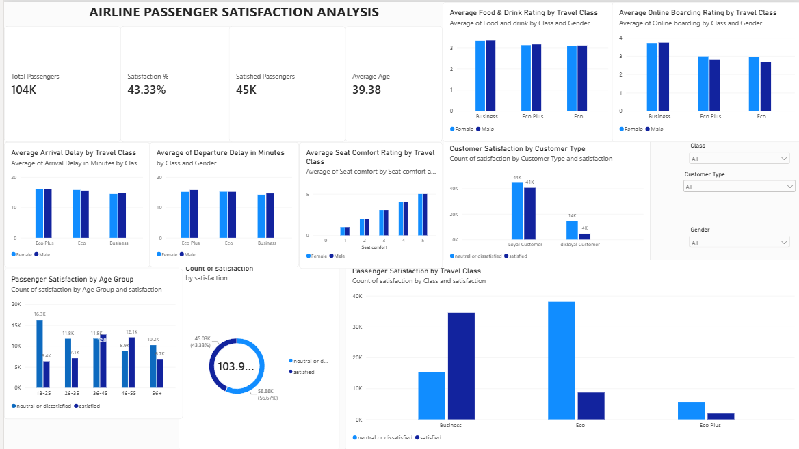

# ✈️ Airline Data Analysis & Operations Dashboard

**An End-to-End Data Analytics Project using Python, SQL, PostgreSQL and Power BI.**

## 📌 About The Project

This project focuses on analyzing airline flight operations, delays, cancellations, airport performance, and passenger satisfaction.

I used Python for data cleaning and preprocessing, PostgreSQL for storing flight data, SQL for analysis, and Power BI to create interactive dashboards.

The project contains two separate analyses:
1. Flight Operations Analysis
2. Passenger Satisfaction Analysis

Both analyses use different datasets and are not joined together.

## 🎯 Project Objectives

- Analyze flight delays and cancellation patterns.
- Compare airline delay performance.
- Explore airport-wise flight activity.
- Identify major reasons for flight delays.
- Analyze passenger satisfaction.
- Present findings through Power BI dashboards.

## 🛠️ Technologies Used

| Technology | Purpose |
|---|---|
| Python | Data cleaning and preprocessing |
| Pandas | Working with datasets |
| PostgreSQL | Storing flight data |
| SQL | Analyzing flight records |
| Power BI | Creating interactive dashboards |
| Jupyter Notebook | Running Python analysis |

## 📂 Project Structure

```text
airline-operations-analytics/
│
├── data/
│   ├── raw/
│   │   ├── airlines.csv
│   │   ├── airports.csv
│   │   ├── flights_subset.csv
│   │   ├── train.csv
│   │   ├── test.csv
│   │   └── flights.csv (not included)
│   │
│   └── processed/
│       ├── flights_clean.csv (generated file)
│       └── passenger_satisfaction_clean.csv (optional)
│
├── notebooks/
│   ├── 01_explore.ipynb
│   ├── 02_load_postgres.ipynb
│   └── sql/
│       ├── schema.sql
│       └── queries.sql
│
├── powerbi/
│   └── airline_dashboard.pbix
│
├── screenshots/
│   ├── airline_operations.png
│   ├── flight_analysis.png
│   └── passenger_satisfaction.png
│
├── requirements.txt
├── .gitignore
└── README.md
```

## 📊 Dashboard Preview

### 1. Airline Operations Dashboard

Shows flight volume, delay rates, cancellation rates, and delay-related information.



### 2. Flight Analysis Dashboard

Shows airport-wise flight activity and delay patterns.



### 3. Passenger Satisfaction Dashboard

Shows passenger satisfaction across different classes, age groups, and onboard services.



## 🔎 Key Insights

### Flight Operations (January–March 2015)

Analysis of a 400,000-flight sample produced the following findings:

- **Delay Rate:** 21.1% of flights that arrived were delayed by 15 minutes or more.
- **Monthly Trend:** January – 21.08%, February – 23.31%, March – 19.28%.
- **Delay Causes:** Late aircraft contributed approximately 39% of delay minutes, airline-related delays 32%, air system 23%, and weather 5%.
- **Cancellations:** Weather accounted for approximately 68% of cancellations.
- **Airline Comparison:** Frontier recorded a 34.97% delay rate, while Southwest recorded 18.97%.

### Passenger Satisfaction

- Total passenger records: approximately 104K.
- Overall satisfaction: 43.33%.
- Satisfied passengers: approximately 45K.
- Average passenger age: 39.38 years.

**Note:** Flight operations and passenger satisfaction are based on separate datasets.

## 🧹 Data Scope & Definitions

- The flight analysis uses a random sample of 400,000 flights from January to March 2015.
- A flight is considered delayed when arrival delay is 15 minutes or more.
- Cancelled and diverted flights are excluded from the arrival delay rate calculation.
- The 13,305 missing arrival-delay values were checked and found to belong to cancelled or diverted flights.
- Missing arrival-delay values were kept empty instead of replacing them with zero.
- Delay cause analysis uses delayed flights only.
- Findings represent this sample and should not be generalized to the entire year or current airline operations.

## 🔍 SQL Analysis

The following analyses were performed using SQL:

1. Airline-wise delay analysis.
2. Airport-wise flight analysis.
3. Cancellation reason analysis.
4. Monthly airline ranking.
5. Month-over-month delay analysis.
6. Delay cause analysis.
7. Hour-wise delay analysis.
8. Day-wise delay analysis.

SQL concepts used:

- SELECT and WHERE
- GROUP BY
- JOIN
- Aggregate Functions
- CTEs
- RANK()
- LAG()

SQL files:

- `notebooks/sql/schema.sql`
- `notebooks/sql/queries.sql`

## 🚀 How to Run the Project

### 1. Clone Repository

```bash
git clone https://github.com/K210605/airline-operations-analytics.git
```

```bash
cd airline-operations-analytics
```

### 2. Create Virtual Environment

```bash
python -m venv venv
```

Activate on Windows:

```bash
venv\Scripts\activate
```

### 3. Install Dependencies

```bash
pip install -r requirements.txt
```

### 4. Prepare Datasets

Place the required CSV files inside:

```text
data/raw/
```

The full `flights.csv` file is not included because of its large size. Use the provided sample or download the original dataset for full-scale analysis.

### 5. Run Python Notebooks

```bash
jupyter notebook
```

Open and run:

- `01_explore.ipynb`
- `02_load_postgres.ipynb`

### 6. Set Up PostgreSQL

- Create a database named `airline_ops`.
- Execute `notebooks/sql/schema.sql`.
- Configure your local PostgreSQL credentials in the loading notebook.
- Run the notebook to load the flight data.

### 7. Run SQL Queries

Open `notebooks/sql/queries.sql` in pgAdmin Query Tool and execute the queries.

### 8. Open Power BI

Open:

`powerbi/airline_dashboard.pbix`

Update the data source paths or connection details if required, then refresh the report.

## 💡 Key Learnings

- Learned to clean and preprocess datasets using Python and Pandas.
- Practiced SQL queries for analyzing flight delays and cancellations.
- Gained experience working with PostgreSQL.
- Created interactive dashboards using Power BI.
- Learned to present data findings through charts and visualizations.

## 🔮 Future Improvements

- Explore flight delay prediction.
- Add more airline performance comparisons.
- Improve dashboard visualizations.

## 👩‍💻 Author

**Khushi Sehgal**

B.Tech – Computer Science & Engineering  
Specialization: Cybersecurity & Privacy

- GitHub: [K210605](https://github.com/K210605)
- LinkedIn: [Khushi Sehgal](https://www.linkedin.com/in/khushi-sehgal-72a9aa286/)

---

⭐ If you find this project useful, feel free to explore the repository!